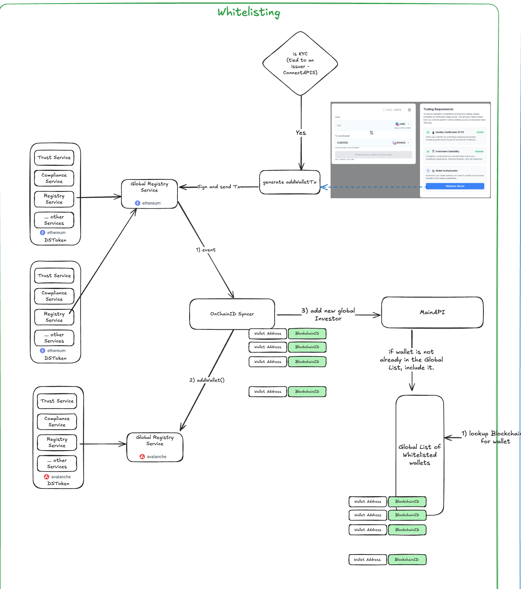

# Global Registry Service

Global Registry Service is a smart contract for managing investors and wallets with a role-based access control. 
Operators can register investors, add wallets, and **pre-approve transactions** using `EIP-712` signatures. Any user 
can execute these **pre-approved transactions** on-chain by submitting the signed payload and paying the transaction fee.
An investor can have up to 255 wallets.

<p align="center">
  
</p>

## Roles and Permissions

The Global Registry Service uses a role-based access control system to manage permissions:

- **OPERATOR**:  
  Responsible for managing investors and wallets within the system.
    - Can register new investors and associate wallets with them.
    - Can remove investors and wallets when necessary.
    - Can pre-approve transactions signing EIP-712 compliant payloads for investor actions.

- **ADMIN**:  
  Oversees the overall system and manages OPERATOR accounts.
    - Can register new OPERATORs and revoke existing ones.
    - Has the authority to update and upgrade smart contracts as needed.
    - It must be a multi-signature or fireblocks wallet to enhance security.

These roles ensure secure and organized management of registry operations, with clear separation of duties between daily 
operations and administrative tasks.

## EIP-712 Signatures

The Global Registry Service supports secure off-chain authorization using EIP-712 signatures. This allows an Operator to 
pre-approve specific actions, which can then be executed on-chain by any user (including investors), who pays the 
transaction fee.


### Signature Flow

1. **Operator signs EIP-712 message**: The Operator creates and signs an EIP-712 structured message authorizing a specific transaction (e.g., associating a wallet, updating investor data). 
2. **Unsigned transaction is generated**:An unsigned transaction is prepared for the executePreApprovedTransaction function, using the signed EIP-712 message as input.
3. **User or investor submits the transaction**: Any user or investor can submit the unsigned transaction to the blockchain, calling executePreApprovedTransaction with the Operator's signature. The sender pays the gas fee, but the action is only executed if the signature is valid and the Operator has the required permissions.

This mechanism enables workflows where **Operators** can authorize actions off-chain, and users can execute them on-chain.

### Relevant Functions:

- `addGlobalInvestorWallet`: Allows associating a wallet with an investor, typically by an Operator. It's the data to execute contained a pre-approved transaction. It uses a block limit to manage the time that pre-approved transaction is valid.
- `executePreApprovedTransaction`: Validates the Operator's EIP-712 signature and executes the pre-approved transaction, regardless of who submits it.

## Deployment

```shell
npm install

```
Add an `.env` file to the project and replace the values defined in `hardhat.config.ts`. Please refer to `.env-example` for guidance

```shell
npx hardhat deploy-all --admin 0x52Ae985C67D4cEE647E93eAa037bA96F7B0C0556 --operator 0x744cee96E39852C82D877eb329378Fcdf99e83F1
```
__Parameters__:

- **admin** param: If set, it will be the ADMIN role holder. If not set, the deployer will be the ADMIN role holder.
- **operator** param: If set, it will be the OPERATOR role holder.

## Contract Verification 

To verify the contracts on a specific network, you need to configure the environment variables with the corresponding 
Etherscan API accounts. For example, we define the following variables in the `.env` file.

For example, the Fuji Avalanche network is open and public, but there are other explorers that require an API key.

```yaml
API_KEY_AVALANCHE=Your-Api-key
API_URL_AVALANCHE=https://api.your-provider.info/v2/network/testnet/evm/43113/etherscan
BROWSER_URL_AVALANCHE=https://testnet.your-porvider.info/blockchain/c
```

```shell
npx hardhat verify-grs --network fuji --proxy 0x1F35e3f472a9362782fa4707100b9280168A2F56 
```
